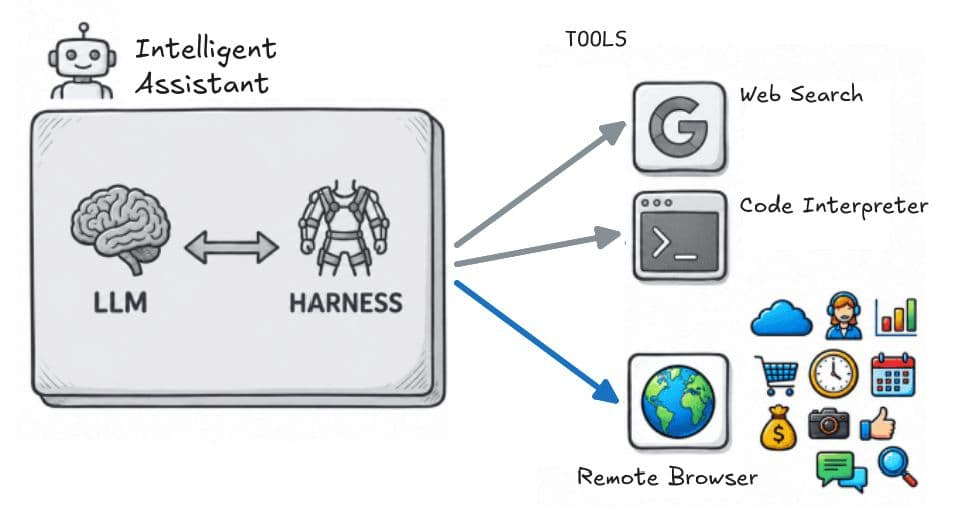
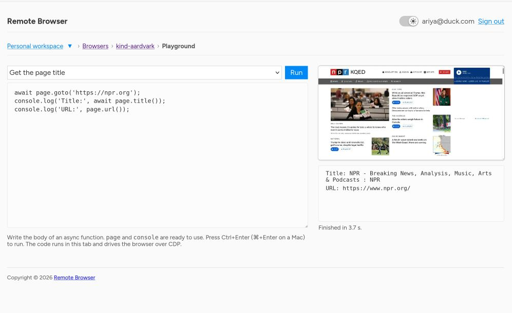

# Remote Browser

[Remote Browser](https://remotebrowser.ai) is an [open-source](https://github.com/remotebrowser/remotebrowser) **browser fleet** for controlling [sandboxed](https://remotebrowser.ai/isolation) web browsers through its [API](https://remotebrowser.ai/api), [SDKs](https://remotebrowser.ai/sdk), and [CLI](https://remotebrowser.ai/cli). It is well suited to any autonomous, intelligent assistant.

It's easy to [deploy](https://remotebrowser.ai/self-hosting) on your own infrastructure. [Give it a try](https://remotebrowser.ai/getting-started)!

For more detailed documentation, visit [remotebrowser.ai](https://remotebrowser.ai).

Remote Browser works with the common web automation tools ([Playwright](https://playwright.dev), [Puppeteer](https://pptr.dev), etc), with autonomous coding assistants ([Claude Code](https://claude.com/product/claude-code), [ChatGPT Codex](https://openai.com/codex), [Cursor](https://cursor.com), [Antigravity](https://antigravity.google), [OpenCode](https://opencode.ai), etc), and with the new generation of personal assistants ([OpenClaw](https://openclaw.ai), [Hermes](https://hermes-agent.nousresearch.com), [Pi](https://pi.dev), etc).

