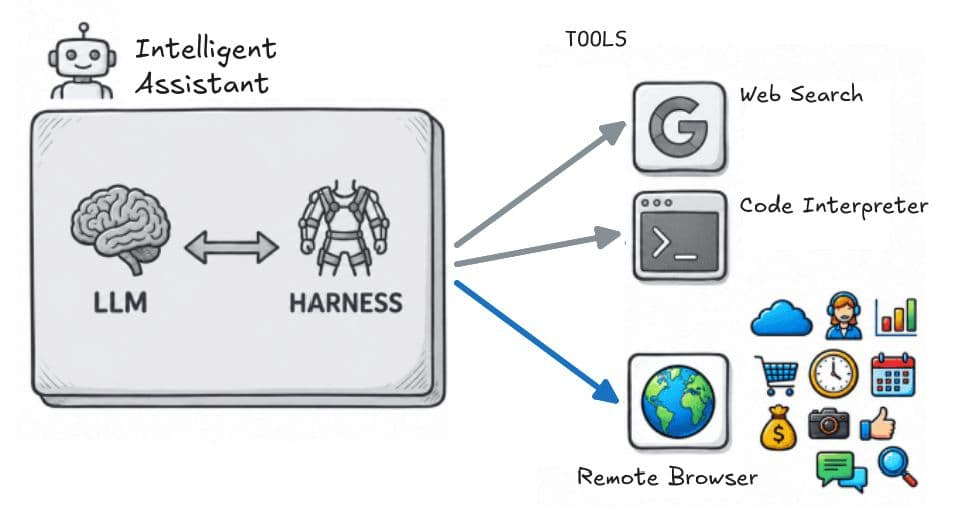

---
hide:
  - title
---

Remote Browser is an [open-source](https://github.com/remotebrowser/remotebrowser) **browser fleet** for launching, [controlling](api.md), and managing [sandboxed](isolation.md) web browsers. It is well suited to any autonomous, intelligent assistant.

It's easy to [deploy](self-hosting.md) on your own infrastructure. [Give it a try](getting-started.md)!

{: style="width: 478px; max-width: 100%; height: auto" }

Remote Browser works with the common web automation tools ([Playwright](https://playwright.dev), [Puppeteer](https://pptr.dev), etc), with autonomous coding assistants ([Claude Code](https://claude.com/product/claude-code), [ChatGPT Codex](https://openai.com/codex), [Cursor](https://cursor.com), [Antigravity](https://antigravity.google), [OpenCode](https://opencode.ai), etc), and with the new generation of personal assistants ([OpenClaw](https://openclaw.ai), [Hermes](https://hermes-agent.nousresearch.com), [Pi](https://pi.dev), etc).
