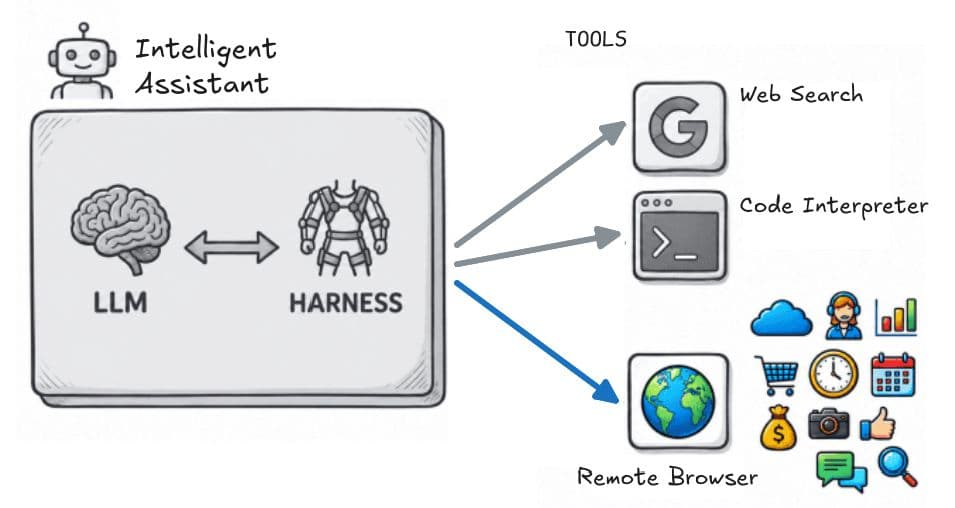

---
hide:
  - title
---

Remote Browser lets your team launch multiple secure, [isolated browser sessions](isolation.md) per user.

It's [free and open source](https://github.com/remotebrowser/remotebrowser), so you can [self-host](self-hosting.md) it in your home lab or deploy to enterprise on-premises for complete data privacy and control.

Intelligent assistants, driven by an LLM and a harness, can remote control these isolated browsers to automate complex business workflows: preparing employee onboardings, managing expenses, generating sales reports, conducting market research, and many more.

Remote Browser works with the common web automation tools ([Playwright](https://playwright.dev), [Puppeteer](https://pptr.dev), etc), with autonomous coding assistants ([Claude Code](https://claude.com/product/claude-code), [ChatGPT Codex](https://openai.com/codex), [Cursor](https://cursor.com), [Antigravity](https://antigravity.google), [OpenCode](https://opencode.ai), etc), and with the new generation of personal assistants ([OpenClaw](https://openclaw.ai), [Hermes](https://hermes-agent.nousresearch.com), [Pi](https://pi.dev), etc).
