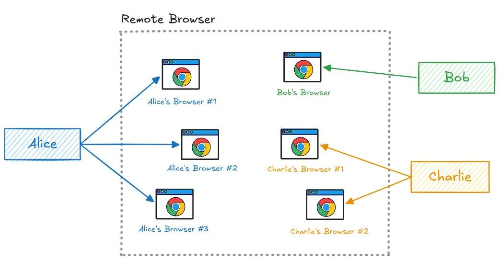

# Isolation

Remote Browser runs every Chromium browser instance in its own **dedicated virtual machine (VM)**.

[Containers](https://csrc.nist.gov/publications/detail/sp/800-190/final) and [process sandboxes](https://chromium.googlesource.com/chromium/src/+/HEAD/docs/design/sandbox.md) share the host kernel. If an attacker finds one kernel bug or escapes one container, they can reach the host and the other browsers on it.

A VM does not share the host kernel. [QEMU/KVM](https://docs.kernel.org/virt/kvm/index.html) uses the hardware virtualization in the CPU ([Intel VT-x](https://en.wikipedia.org/wiki/X86_virtualization#Intel-VT-x) or [AMD-V](https://en.wikipedia.org/wiki/X86_virtualization#AMD-V)) to keep the memory and devices of each VM apart. This is a **much stronger boundary** than a container, with **negligible performance overhead**.

Each VM starts from a clean disk and holds only the session of the browser it runs. Users reach their own browsers through the app, and one user cannot reach another user's browsers.

The diagram shows three users on a single Remote Browser system.

Alice is a software engineer who needs to read documentation for an internal company service, research different technical trade-offs, and test the apps she is working on. She starts three browsers and uses them at the same time.

Meanwhile, Bob works in accounting and is happy automating his workflow with only a single browser.

For product research, Charlie needs to remote-control two different browsers while on the go. He accesses them using his LLM-powered assistants through Telegram.

Each browser is a separate VM, so what one user does inside their browser cannot affect any other browser running on the same host.
